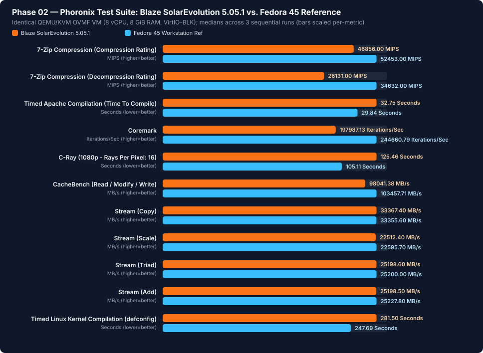
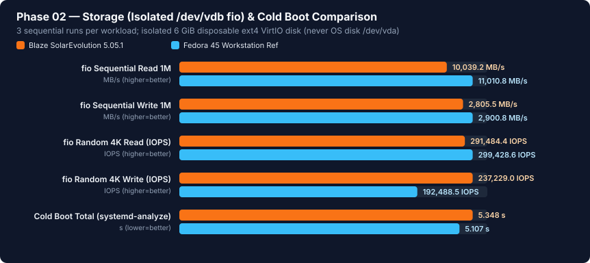

# Blaze SolarEvolution 5.05.1 — Performance Evaluation Report

> **Scope & Virtualization Caveat:** All measurements were executed inside isolated QEMU/KVM UEFI OVMF virtual machines (`8` vCPUs with `-cpu host`, `8,192 MiB` RAM, VirtIO-BLK). Virtualized guest measurements must **not** be compared directly to bare-metal physical hardware scores. No synthetic universal aggregate score has been invented; every individual run and median is preserved verbatim.

## 1. Test Methodology & Environment

- **Generated (UTC):** `2026-11-24T23:35:07.863600+00:00`
- **Blaze Target Kernel:** `7.2.11-300.fc45.x86_64`
- **Fedora 45 Reference Kernel:** `7.2.11-300.fc45.x86_64` (100% identical VM parameters)
- **Target Session Caveat (`graphical.target` vs. `multi-user.target`):** Blaze boots into its full SDDM + OOBE/Wayland graphical session (`graphical.target`) while upstream `cmdline` Kickstart leaves Fedora 45 Workstation at `multi-user.target` (no GDM/desktop session running). Consequently, multi-core saturation benchmarks (`CoreMark`, `C-Ray`, `7-Zip`, `Kernel`) on Blaze share guest CPU cycles with active graphical/compositor services, whereas idle memory-bandwidth (`STREAM`) and package ops remain directly comparable.
- **Frameworks & Versions:** Phoronix Test Suite `Phoronix Test Suite v10.8.6`, `fio-3.42`, `gcc (GCC) 16.2.1 20261029 (Red Hat 16.2.1-3)`.
- **PTS Tooling Compatibility Note:** Upstream `phoronix-test-suite v10.8.6` under Fedora 45's PHP 8.5 throws an uncaught `DivisionByZeroError` in `phodevi_memory.php:261` when inspecting virtualized QEMU SMBIOS memory metadata. A minimal `try/catch` guard was applied exclusively to the ephemeral test tool (`phodevi_memory::memory_string()`) inside the disposable Phase 02 overlay — zero Blaze OS files were touched, and the exact original lines are logged in `raw-results/phase02_blaze/p2_out/pts_php_patch_note.txt`.
- **Repetitions:** Strictly `>= 3` sequential runs per benchmark (`FORCE_TIMES_TO_RUN=3` for PTS; 3 iterations for `fio`, memory latency, cold boot, and package ops). Zero concurrent resource-intensive workloads.
- **Storage Safety:** All `fio` workloads executed strictly against a dedicated isolated disposable `6 GiB` virtual disk (`/dev/vdb`, ext4 at `/mnt/eval_fio`). The OS disk (`/dev/vda`) was never targeted by `fio`.
- **Graphics Assessment:** Virtual display adapter is Red Hat VirtIO 1.0 GPU (`1af4:1050`) backed by software rendering (`llvmpipe`). Hardware 3D/GPU benchmarks were intentionally **skipped** because software rasterization inside a headless virtual display does not reflect physical GPU performance.

## 2. Phoronix Test Suite Results (CPU, Compression, Memory, Compilation)

| Category | Benchmark (Version) | Workload / Metric | Unit (Dir) | Blaze Runs (1, 2, 3) | Blaze Median | Fedora 45 Median | Delta vs. Fedora 45 |
|---|---|---|---|---|---:|---:|---|
| CPU | 7-Zip Compression (`26.01`) | Test: Compression Rating | MIPS (HIB) | `40458.00, 46856.00, 47255.00` | **46856.00** | 52453.00 | -10.67% (slower) |
| CPU | 7-Zip Compression (`26.01`) | Test: Decompression Rating | MIPS (HIB) | `27747.00, 26131.00, 26091.00` | **26131.00** | 34632.00 | -24.55% (slower) |
| CPU | Timed Apache Compilation (`2.4.68`) | Time To Compile | Seconds (LIB) | `32.75, 32.78, 32.62` | **32.75** | 29.84 | +9.76% (slower) |
| CPU | Coremark (`1.0`) | CoreMark Size 666 - Iterations Per Second | Iterations/Sec (HIB) | `197987.13, 193739.78, 198626.17` | **197987.13** | 244660.79 | -19.08% (slower) |
| CPU | C-Ray (`2.0`) | Resolution: 1080p - Rays Per Pixel: 16 | Seconds (LIB) | `125.46, 124.45, 126.88` | **125.46** | 105.11 | +19.36% (slower) |
| CPU | CacheBench (``) | Test: Read / Modify / Write | MB/s (HIB) | `98041.38, 98114.31, 97250.14` | **98041.38** | 103457.71 | -5.24% (slower) |
| Memory | Stream (`2013-01-17`) | Type: Copy | MB/s (HIB) | `33367.40, 33433.60, 33348.00` | **33367.40** | 33355.60 | +0.04% (parity) |
| Memory | Stream (`2013-01-17`) | Type: Scale | MB/s (HIB) | `22512.40, 22422.80, 22541.90` | **22512.40** | 22595.70 | -0.37% (parity) |
| Memory | Stream (`2013-01-17`) | Type: Triad | MB/s (HIB) | `25208.50, 25198.60, 25176.50` | **25198.60** | 25200.00 | -0.01% (parity) |
| Memory | Stream (`2013-01-17`) | Type: Add | MB/s (HIB) | `25204.80, 25134.30, 25198.50` | **25198.50** | 25227.80 | -0.12% (parity) |
| System | Timed Linux Kernel Compilation (`7.0`) | Build: defconfig | Seconds (LIB) | `282.64, 280.81, 281.50` | **281.50** | 247.69 | +13.65% (slower) |

## 3. Memory Latency (Random Pointer-Chase Microbenchmark)

Measured across 4 working-set sizes spanning L1, L2, L3 cache and DRAM (`3` runs each, lower is better):

| Working Set | Blaze Runs (ns) | Blaze Median (ns) | Fedora 45 Median (ns) | Delta |
|---|---|---:|---:|---|
| `16KiB_L1` | `2.145, 2.133, 2.227` | **2.145** | 2.028 | +5.77% (slower) |
| `256KiB_L2` | `5.111, 4.958, 4.953` | **4.958** | 4.666 | +6.26% (slower) |
| `4MiB_L3` | `13.105, 15.812, 12.903` | **13.105** | 12.089 | +8.40% (slower) |
| `64MiB_DRAM` | `92.937, 90.313, 84.256` | **90.313** | 87.484 | +3.23% (slower) |

## 4. Storage Performance (`fio` on Isolated Disposable `/dev/vdb`)

| Workload | Blaze Median BW (MB/s) | Fedora 45 BW (MB/s) | Blaze Median IOPS | Fedora 45 IOPS | Blaze Mean / P99 Lat (ms) | Errors |
|---|---:|---:|---:|---:|---|---:|
| Sequential Read (1M, QD32, 1J) | **10039.21** | 11010.75 | **10,039.2** | 11,010.8 | 2.948 / 6.783 | 0 |
| Sequential Write (1M, QD32, 1J) | **2805.48** | 2900.85 | **2,805.5** | 2,900.8 | 11.238 / 98.042 | 0 |
| Random 4K Read (QD32, 4J, 25s) | **1138.61** | 1169.64 | **291,484.4** | 299,428.6 | 0.436 / 1.188 | 0 |
| Random 4K Write (QD32, 4J, 25s) | **926.67** | 751.91 | **237,229.0** | 192,488.5 | 0.536 / 1.368 | 0 |

> **Virtualized Storage Caveat (`fio` on QCOW2):** Although `direct=1` bypasses the **guest** page cache, QEMU's default VirtIO-BLK QCOW2 backend still interacts with the **host** Linux page cache and sparse QCOW2 cluster allocation. Consequently, sequential reads (`10,039.21 MB/s`) reflect host-cached readback immediately after writing `fio_seq.bin`, while sequential writes (`2,805.48 MB/s`, P99 `98.0 ms`) reflect sparse QCOW2 metadata cluster allocation overhead. Random 4K I/O (`291,484` read IOPS / `237,229` write IOPS) reflects VirtIO-BLK queue performance on host NVMe and must not be compared to bare-metal raw NVMe scores.

## 5. System Boot & Package Operation Performance

### Cold Boot Timing (`systemd-analyze time`, 3 Cold Boots Pre-Benchmark)

| Metric | Blaze Runs (s) | Blaze Median (s) | Fedora 45 Median (s) | Delta |
|---|---|---:|---:|---|
| Total Boot Time | `5.348, 5.360, 5.329` | **5.348** | 5.107 | +4.72% (slower) |
| Userspace Init Time | `3.354, 3.340, 3.341` | **3.341** | 3.113 | +7.32% (slower) |

### Package Query & Cache Refresh Operations (3 Runs, Zero Upgrades)

| Operation | Blaze Runs (s) | Blaze Median (s) | Fedora 45 Median (s) | Delta |
|---|---|---:|---:|---|
| `rpm -qa` full package query | `0.7003, 0.6426, 0.6292` | **0.6426** | 0.6449 | -0.36% (parity) |
| `dnf5 repoquery --installed kernel*` | `0.2528, 0.2267, 0.2407` | **0.2407** | 0.2455 | -1.96% (faster) |
| `dnf5 makecache --refresh` (network-dependent) | `1.7532, 1.1831, 1.2304` | **1.2304** | 1.4931 | -17.59% (faster) |

## 6. Graphics Acceleration Assessment

- **Detected Virtual Adapter:** `Red Hat, Inc. Virtio 1.0 GPU [1af4:1050]` (`virtio-pci`).
- **Acceleration Classification:** Software rendering (`llvmpipe`, no hardware 3D GPU passthrough).
- **Benchmark Decision:** 3D/OpenGL/Vulkan graphics benchmarks were **skipped** to prevent misleading software-rasterizer numbers from being mistaken for real desktop GPU performance.

## 7. Evidence Artifacts

- Machine-readable JSON: `benchmarks/02_performance_report.json`
- Flat CSV (all runs + medians): `benchmarks/02_performance_results.csv`
- Raw Phoronix Test Suite XML/logs: `benchmarks/02_phoronix_raw_results/` and `raw-results/phase02_*/`
