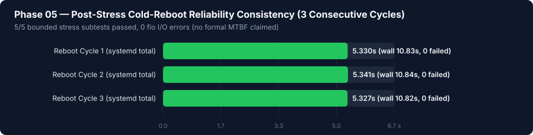

# Blaze SolarEvolution 5.05.1 — Reliability and Stress Evaluation Report

> **Scope & MTBF Disclaimer:** All stress tests used bounded durations inside an isolated QEMU/KVM virtual machine. Short-duration stress results validate functional stability under bounded load and **do not establish a formal Mean Time Between Failures (MTBF)**. Memory pressure tests (`stress-ng --vm`) evaluate guest-level virtual memory allocation and integrity — **not** physical host RAM hardware diagnostics.

## 1. Summary Reliability Metrics

| Reliability Metric | Measured Result |
|---|---|
| Bounded Stress Subtest Completion Rate | **`100.0%`** (`5/5` passed) |
| Storage `fio` I/O & CRC32C Verification Errors | **`0`** |
| Unexpected Reboots / Shutdowns | **`0`** |
| Unexpected Service Failures (Post-Stress & All 3 Reboots) | **`0`** (`0` failed units) |
| Initrd `/sbin/blockdev` Udev Callout Warnings | **`0`** |
| Kernel Errors (`dmesg -l err,crit,alert,emerg`) | `1` line(s) post-stress |
| Median Cold Boot Duration (3 Post-Stress Cycles) | **`5.330 s`** |

### Side-by-Side Reliability vs. Upstream Fedora 45 Workstation

| Metric | Blaze SolarEvolution 5.05.1 | Fedora 45 Workstation Ref |
|---|---:|---:|
| Stress Subtest Pass Rate | **`100.0%`** (5/5) | 100.0% (5/5) |
| `fio` I/O & CRC32C Errors | **`0`** | 0 |
| Failed Systemd Units | **`0`** | 0 |
| Median Cold Boot (Post-Stress Cycles) | **`5.330 s`** | 5.124 s |

## 2. Bounded CPU, Guest Memory & Isolated Storage Stress Results

Tools used: `stress-ng, version 0.22.02 (gcc 16.2.1, x86_64 Linux 7.2.11-300.fc45.x86_64)` and `fio-3.42` (installed strictly inside the ephemeral overlay).

| Subtest | Workload & Safety Bounds | Duration | Throughput / Ops | Integrity Verification | Exit Code |
|---|---|---:|---|---|---:|
| CPU Short Validation | `stress-ng --cpu 8 --cpu-method matrixprod --verify` | 30.00 s | `369,505` bogo ops (`12,316.61`/s) | Verified (`failed: 0`, `untrustworthy: 0`) | `0` |
| CPU Sustained Multi-Method | `stress-ng --cpu 8 --cpu-method all --verify` | 90.00 s | `1,087,930` bogo ops (`12,087.99`/s) | Verified (`failed: 0`, `untrustworthy: 0`) | `0` |
| Guest Memory Pressure & Integrity | `stress-ng --vm 4 --vm-bytes 1G --vm-keep --verify` (4 GiB = 50% of guest RAM) | 90.05 s | `29,329,224` bogo ops (`325,684.83`/s) | Verified (`failed: 0`, `0` OOM kills) | `0` |
| Isolated Storage Mixed Random 4K | `fio` 70/30 `randrw`, 4 jobs, QD32, `direct=1` on disposable `/dev/vdb` | 90.0 s | R: `381.46` MB/s (`97,654` IOPS, P99 `1.335` ms); W: `163.49` MB/s (`41,853` IOPS, P99 `1.958` ms) | `0` I/O errors | `0` |
| Isolated Storage CRC32C Integrity | `fio` 1 GiB 128K write + `verify=crc32c` (`verify_fatal=1`) on disposable `/dev/vdb` | Completed | Write `701.37` MB/s; Readback Verify `5417.99` MB/s | `0` CRC32C verification errors | `0` |

## 3. Boot & Service Reliability Across 3 Consecutive Cold Reboots

| Reboot Cycle | Kernel (s) | Initrd (s) | Userspace (s) | Total `systemd-analyze` (s) | Wall Reboot Time (s) | Failed Units | Service Restarts | Journal Error Lines |
|---|---:|---:|---:|---:|---:|---:|---|---:|
| Cycle 1 | 0.399 | 1.604 | 3.326 | **5.330** | 10.83 | 0 | `systemd-journald.service NRestarts=1` | 29 |
| Cycle 2 | 0.401 | 1.596 | 3.344 | **5.341** | 10.84 | 0 | `systemd-journald.service NRestarts=1` | 29 |
| Cycle 3 | 0.398 | 1.601 | 3.326 | **5.327** | 10.82 | 0 | `systemd-journald.service NRestarts=1` | 29 |

## 4. Evidence Artifacts

- Structured stress & reboot telemetry: `evidence/05_stress_results.json`
- Boot critical-chain & blame report: `evidence/05_boot_analysis.txt`
- System error & dmesg log: `evidence/05_system_errors.log`
