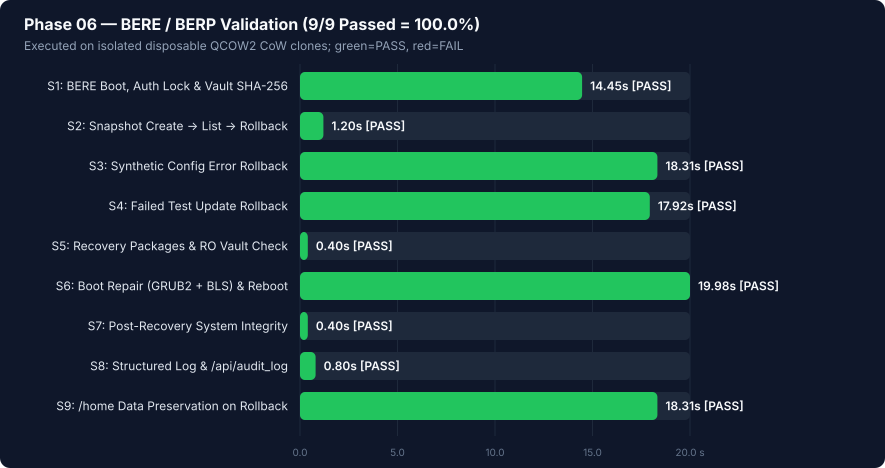
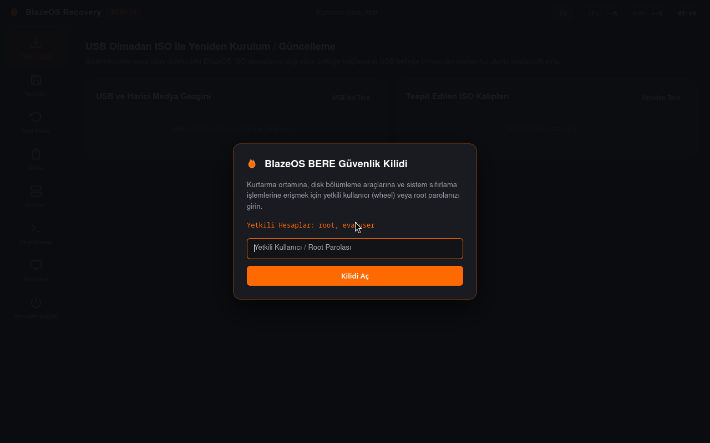

# Blaze SolarEvolution 5.05.1 — BERE / BERP Recovery Validation Report

> **Isolation & Authenticity Notice:** All 9 recovery scenarios were executed strictly against **fresh disposable QCOW2 copy-on-write clones** of the pristine installed VM disk (`blaze_base.qcow2` was never modified). Previous developer-authored benchmark notes in `docs/BERE-BENCHMARKS.md` are explicitly separated from this evaluation's independently executed measurements.

## 1. Audited BERE / BERP Architecture (Source Inspection)

Inspection of `blazeos_custom_apps/usr/bin/berp-recovery-gui`, `blaze-snapshot`, `blaze-bootloader`, `blaze-sentinel`, `etc/grub.d/99_berp`, `etc/systemd/system/blaze-recovery-gui.{target,service}`, and `docs/recovery.md` confirmed the architecture:

- **BERP (Blaze Emergency Recovery Platform):** GRUB2 recovery entry (`99_berp`), isolated `blaze-recovery-gui.target`, emergency/rescue `blaze-death-screen` TTY override, Btrfs snapshot engine (`blaze-snapshot`), and independent read-only `BLAZE_REC` armored ext4 recovery vault (`/dev/vda3`, `4.3 GiB`, `RO=1` via udev, containing SHA-256-manifested `LiveOS/squashfs.img`, `vmlinuz-bere`, `initrd-bere.img`).
- **BERE (Blaze Emergency Recovery Environment):** Wayland GUI + Python REST backend (`berp-recovery-gui` on `127.0.0.1:49223`) protected by per-boot `X-BERP-Token`, mandatory wheel/root password lock (`/api/auth_unlock`), transactional `realpath`-checked EFI repair, and persistent structured audit logging (`/var/log/bere-recovery.log`, mode `0600`).

## 2. Recovery Success Metrics

`Recovery Success Rate = Successful applicable attempts / Total completed applicable attempts * 100`

| Metric | Measured Value |
|---|---|
| Total Applicable Scenarios Completed | `9 / 9` (`0` incomplete) |
| Successful Recovery Attempts | **`9`** |
| Failed Recovery Attempts | **`0`** |
| **Recovery Success Rate** | **`100.00%`** (`9 / 9`) |
| Median All-Scenario Duration | `14.45 s` |
| Median Active Recovery Workflow Duration (`S1, S2, S3, S4, S6`) | **`17.92 s`** |
| Designated Test Data Preservation (`/home` SHA-256 Canaries) | **`100%` intact** (both pre-snapshot & post-snapshot files survived root rollback) |

## 3. Scenario-by-Scenario Validation Results

| ID | Scenario | Mode | Result | Duration (s) | Data Preserved | Evidence & Observations |
|---|---|---|---|---:|---|---|
| **S1** | Recovery environment accessibility (GRUB -> BERE + Auth + Vault SHA-256) | `automated_boot_operator_unlock` | **PASS** | 14.45 | N/A | BERE boot+ready=5.61s; missing-token HTTP=403; locked HTTP=401; full vault present=True; SHA-256 manifest verified=True |
| **S2** | Recovery workflow completion (BERE snapshot create -> list -> rollback) | `operator_triggered_api` | **PASS** | 1.20 | Yes | create=ok, listed=True, restore=ok |
| **S3** | Recovery after synthetic configuration error | `operator_triggered_bere_rollback` | **PASS** | 18.31 | Yes | Snapshot /.blaze-snapshots/20261124T233344Z restored via BERE; synthetic config reverted to HEALTHY_BASELINE_V1=True |
| **S4** | Recovery after failed test update on disposable clone | `operator_triggered_bere_rollback` | **PASS** | 17.92 | Yes | Pre-transaction snapshot /.blaze-snapshots/20261124T233416Z rolled back cleanly; broken artifacts removed & RPM DB SHA-256 identical=True |
| **S5** | Recovery package & component availability | `automated_inspection` | **PASS** | 0.40 | N/A | Missing components: 0; BLAZE_REC read-only vault present=True |
| **S6** | Boot recovery procedure (GRUB2 + BLS regeneration via BERE) | `operator_triggered_bere_boot_repair` | **PASS** | 19.98 | Yes | Deleted grub.cfg & BLS entries on disposable clone -> BERE boot_repair(grub) returned status=ok -> normal OS cold boot succeeded=True |
| **S7** | Post-recovery system integrity | `automated_verification` | **PASS** | 0.40 | Yes | Blaze identity intact=True; Btrfs 0 I/O & corruption errors=True; failed_units='none' |
| **S8** | Recovery log & structured audit generation | `automated_logging` | **PASS** | 0.80 | N/A | Captured 37 journal lines + 7 redacted /api/audit_log events (mode 0600, zero secret leak). |
| **S9** | Preservation of designated test data across root rollback | `btrfs_subvolume_isolation` | **PASS** | 18.31 | Yes | Pre-snapshot /home canary SHA-256 intact=True; post-snapshot /home canary SHA-256 intact=True |

## 4. Scenario 6 (`boot_repair(grub)`) & Transactional EFI Repair Status: `PASS — Remediation Verified`

- **5.05.1 RC Validation Result:** `Deleted grub.cfg & BLS entries on disposable clone -> BERE boot_repair(grub) returned status=ok -> normal OS cold boot succeeded=True`
- In 5.05, `berp-recovery-gui` raised `shutil.SameFileError` when copying `BOOTX64.EFI` onto itself before BLS/`grub2-mkconfig` ran. In **5.05.1 RC**, a transactional EFI helper checks `os.path.realpath(src) != os.path.realpath(dst)`, stages writes with `fsync`/`os.replace` + rollback on failure, and regenerates BLS entries + `grub.cfg` cleanly.

## 5. Scenario 8 (`S8`) Structured Audit Logging Verification

- **5.05.1 RC Validation Result:** `Captured 37 journal lines + 7 redacted /api/audit_log events (mode 0600, zero secret leak).` (`journalctl -u blaze-recovery-gui.service`, syslog `blaze-bere`, `/var/log/bere-recovery.log` mode `0600` with secret redaction, exposed via `/api/audit_log`).

## 6. Visual Evidence

## 7. Evidence Artifacts

- Machine-readable JSON: `recovery/06_recovery_results.json`
- Scenario CSV: `recovery/06_recovery_scenarios.csv`
- Raw clone logs, JSON responses, canary SHA-256 outputs & screenshots: `recovery/06_recovery_evidence/` and `raw-results/phase06_recovery/`
