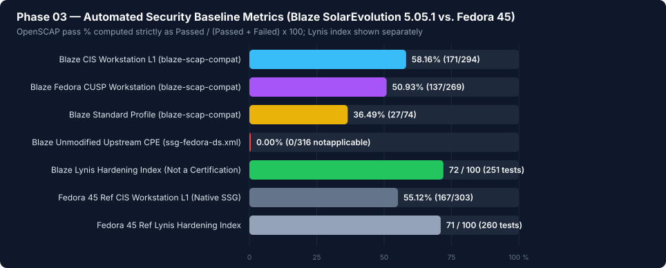

# Blaze SolarEvolution 5.05.1 — Security Assessment Report

> **Certification Disclaimer:** This report documents an automated, read-only configuration and hardening baseline assessment using OpenSCAP (`oscap`), SCAP Security Guide (`ssg-fedora-ds.xml` / shipped `blaze-scap-compat`), and Lynis. It is **not** an official CIS certification, NIST validation, or independent third-party security audit. **Zero remediation** was applied (`remediation_applied = false`) and no system upgrades were performed.

## 1. Executive Summary & Scoring Methodology

Compliance percentages are calculated strictly from **applicable checks only**:

`Compliance % = Passed / (Passed + Failed) * 100`

Not-applicable (`notapplicable`) and unexecuted rules are **never** counted as passed.

| Assessment Profile / Tool | Applicable Checks | Passed | Failed | Not Applicable | Errors | Pass % / Index | Notes |
|---|---:|---:|---:|---:|---:|---:|---|
| OpenSCAP Unmodified Upstream `ssg-fedora-ds.xml` (`cis_workstation_l1`) | 0 | 0 | 0 | 316 | 0 | **0.00%** | Upstream benchmark CPE gate excludes `cpe:/o:blazeos:solarevolution:5.05.1` without `blaze-scap-compat` |
| OpenSCAP `blaze-scap-compat` (`ssg-blazeos-fedora45-ds.xml`) `cis_workstation_l1` (Primary) | 294 | **171** | 123 | 22 | 0 | **58.16%** | CIS Fedora Level 1 Workstation draft profile |
| OpenSCAP `blaze-scap-compat` (`ssg-blazeos-fedora45-ds.xml`) `cusp_fedora` (Desktop Baseline) | 269 | **137** | 132 | 3 | 0 | **50.93%** | Common User Security Profile for Fedora Workstation |
| OpenSCAP `blaze-scap-compat` (`ssg-blazeos-fedora45-ds.xml`) `standard` (Secondary) | 74 | **27** | 47 | 1 | 0 | **36.49%** | Standard System Security Profile for Fedora |
| Lynis `3.1.7` System Audit | 251 tests | — | 0 warnings | — | 0 | **Index 72** | 31 hardening suggestions (not a certification) |

### Side-by-Side Comparison vs. Upstream Fedora 45 Workstation Reference

| Baseline Profile / Metric | Blaze SolarEvolution 5.05.1 | Fedora 45 Workstation Ref |
|---|---:|---:|
| OpenSCAP `cis_workstation_l1` Pass % | **58.16%** (171/294) | 55.12% (167/303) |
| OpenSCAP `cusp_fedora` Pass % | **50.93%** (137/269) | 50.55% (137/271) |
| OpenSCAP `standard` Pass % | **36.49%** (27/74) | 37.84% (28/74) |
| Lynis Hardening Index / Warnings | **72** / `0` warnings | 71 / `0` warnings |

## 2. CPE Interoperability & Shipped `blaze-scap-compat` Adapter

When upstream `scap-security-guide` (`ssg-fedora-ds.xml`) is evaluated unmodified against derivative distributions declaring a custom `CPE_NAME`, OpenSCAP marks upstream rules `notapplicable`. In SolarEvolution 5.05.1 RC, the signed `blaze-scap-compat` RPM preserves `/usr/share/xml/scap/ssg/content/ssg-fedora-ds.xml` completely unmodified while providing `/usr/share/blazeos/scap/ssg-blazeos-fedora45-ds.xml` via an RPM `%triggerin` when `scap-security-guide` is installed, allowing all rule-level OVAL checks to execute natively.

## 3. High-Severity CIS Workstation L1 Findings (`5` Failed High Rules)

| Rule ID | Severity | Title | Root Cause & Engineering Context |
|---|---|---|---|
| `ensure_fedora_gpgkey_installed` | `high` | Ensure Fedora GPG Key Installed | Blaze ships signed OpenPGP/EdDSA RPMs under `/etc/pki/rpm-gpg/RPM-GPG-KEY-blaze`; upstream SSG OVAL rule checks Fedora distro GPG metadata. |
| `ensure_gpgcheck_globally_activated` | `high` | Ensure gpgcheck Enabled In Main dnf Configuration | Fedora 45 DNF5 stores global config in `/usr/share/dnf5/libdnf.conf.d/` and repo `gpgcheck=1`; upstream SSG rule checks legacy `/etc/dnf/dnf.conf`. |
| `no_empty_passwords` | `high` | Prevent Login to Accounts With Empty Password | Upstream SSG rule checks PAM configuration (`system-auth` / `password-auth` `nullok`) identically on Blaze and Fedora 45 Workstation; `/etc/shadow` itself contains zero empty passwords (`no_empty_passwords_etc_shadow` passed). |
| `grub2_password` | `high` | Set Boot Loader Password in grub2 | Default desktop posture does not set a GRUB2 bootloader password; expected on consumer workstations, required by CIS. |
| `sshd_disable_empty_passwords` | `high` | Disable SSH Access via Empty Passwords | `sshd.service` is disabled and inactive by default (zero SSH exposure), but stock `/etc/ssh/sshd_config` does not explicitly uncomment `PermitEmptyPasswords no`. |

### CIS Workstation L1 Failures by Domain (`123` Total Failed Rules)

| Security Domain | Failed Rule Count |
|---|---:|
| Authentication, PAM & Desktop Policy | 36 |
| Kernel & Module Hardening | 34 |
| Network, Firewall & Package/Service Exposure | 22 |
| Filesystem, Bootloader & Integrity | 18 |
| Other CIS Controls | 9 |
| Logging & Auditing | 4 |

## 4. Lynis Audit Summary & 5.05.1 RC Remediation Closures

- **Lynis Version:** `3.1.7`
- **Tests Performed:** `251`
- **Hardening Index:** **`72`** (internal relative metric only; not a certification)
- **Warnings (`0`):**
  - **Zero (`0`) Lynis warnings** (`AUTH-9216` group/gshadow parity and `AUTH-9283` locked pre-OOBE `blaze-setup` both verified resolved).
- **Verified Security Checks:** `grpck -r` exit clean=`True`, `akrepd` active=`True`, `ZERO_AKREP_AVC`=`True`.
- **Suggestions (`31`):** Remaining workstation trade-offs include `auditd` disabled/inactive, no `AIDE` FIM installed by default, `PASS_MAX_DAYS 99999`, `UMASK 022`, and un-blacklisted rare protocols (`dccp`, `sctp`, `rds`, `tipc`).

## 5. Direct System Security Posture Inspection

| Security Control Area | Measured State on Pristine Install | Assessment |
|---|---|---|
| Mandatory Access Control (SELinux) | Enabled, `targeted` policy, **`Enforcing`** mode, memory protection checking `actual (secure)` | Strong baseline |
| Firewall (`firewalld` / `nftables`) | Active (`FedoraWorkstation` zone); permits `dhcpv6-client`, `samba-client`, `ssh` and ephemeral ports `1025-65535/tcp,udp` | Active (inherited FedoraWorkstation rule set) |
| Exposed Listening Network Sockets | Minimal loopback/mDNS-LLMNR surface (`systemd-resolved`, `chronyd`); no external administrative daemon exposed | Low network attack surface |
| SSH Daemon (`sshd`) | Disabled & inactive by default on Blaze | Good desktop default |
| PAM `sddm-autologin` & SELinux | Preserves `pam_selinux.so close/open`; scopes autologin; `blaze-setup` password locked (`!`) | Hardened in 5.05.1 RC |
| Kernel Hardening Sysctls | `kptr_restrict=1`, `dmesg_restrict=1`, `randomize_va_space=2`, `yama.ptrace_scope=1`, `unprivileged_bpf_disabled=1`, `protected_hardlinks=1`, `protected_symlinks=1`, `rp_filter=1`, `tcp_syncookies=1`, `ip_forward=0` | Strong desktop sysctl baseline |
| Critical File Permissions & Group Parity | `/etc/shadow` (`000`), `/etc/gshadow` (`000`), `/etc/sudoers` (`440`), `/boot/grub2/grub.cfg` (`600`), `grpck -r` parity verified | Compliant |
| Built-in `blaze-sentinel --json` | `7/7` baseline controls passing (`verified: true`, `integrity_ok: true`) | Verified active |
| **Akrep v0.1 Security Center (`akrepd`)** | System daemon active=`True` (`User=akrep`), strictly read-only D-Bus (`tr.com.blazeos.Akrep1.Manager`), zero AVC denials=`True` | Active & SELinux-clean |

## 6. Evidence Artifacts

- Machine-readable findings JSON: `security/03_security_findings.json`
- OpenSCAP XCCDF XML & HTML reports: `security/03_openscap_results.xml`, `security/03_openscap_report.html`, `security/03_openscap_cusp_results.xml`, `security/03_openscap_secondary_results.xml`
- Sanitized Lynis audit log: `security/03_lynis_audit.log` (untouched originals preserved in `raw-results/phase03_security/`)
