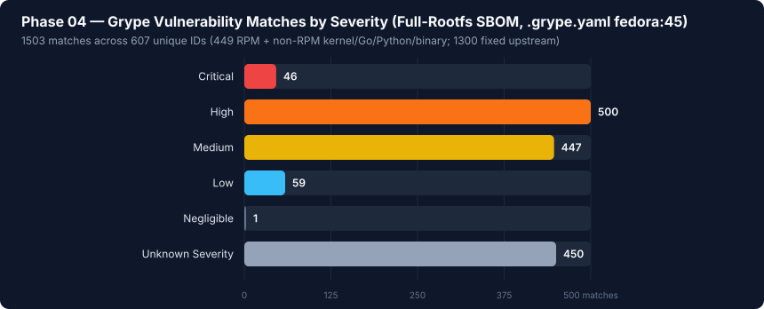

# Blaze SolarEvolution 5.05.1 — Software Supply Chain Assessment Report

> **Evaluation Invariant:** Per Section 2 safety rules, **no `dnf upgrade` was executed** on the evaluated system. Vulnerability findings therefore measure the exact un-updated frozen base ISO snapshot against the latest Grype advisory database.

## 1. Tooling, Database Freshness & SBOM Inventory

- **SBOM Generator:** `syft v1.57.2` (`linux/amd64`, CycloneDX & SPDX JSON, scope: `dir:/ (full rootfs excluding virtual/cache mounts)`)
- **Vulnerability Scanner:** `grype v0.122.1` (`linux/amd64`)
- **Grype Database:** Schema `v6.1.10`, Built **`2026-11-24T06:22:05Z`**, Status **`valid=True`**.
- **CycloneDX JSON (`sbom/04_sbom_cyclonedx.json`):** `129,882` components inventoried (`1904` installed RPMs plus kernel, Python, Go modules, Cargo/Rust & ELF artifacts).
- **SPDX JSON (`sbom/04_sbom_spdx.json`):** `7,220` packages inventoried with versions, purls, and dependency metadata.
- **First-Party Blaze Signed RPMs Indexed:** **`14`** first-party RPM packages present in `rpmdb.sqlite` and CycloneDX/SPDX SBOMs (`15` Blaze-prefixed/named SBOM RPM entries).

## 2. Supply Chain Identity & Packaging Findings

### Finding A — `.grype.yaml` Explicit Advisory Feed Policy vs. Auto-Detection

Running `grype sbom:04_sbom_cyclonedx.json` without `.grype.yaml` returned **`1054` matches** (skipping Fedora distro RPM feeds for `ID=blazeos`), whereas scanning with `.grype.yaml` (`distro: "fedora:45"`) resolved **`1503` total matches across `607` unique CVEs/advisories** (`449` RPM matches + `1054` non-RPM matches: `linux-kernel`: 828, `rpm`: 449, `go-module`: 122, `python`: 86, `binary`: 18).

### Finding B — First-Party Package Provenance & Ownership

Unlike initial 5.05 assembly (where only `blaze-release` was in `rpmdb`), Blaze SolarEvolution 5.05.1 ships **`14` signed first-party RPMs** covering `blaze-release`, `blaze-sentinel`, `blaze-tools`, `blaze-recovery`, `blaze-continuum`, `blaze-house`, `solarui`, `solarui-config`, `blaze-oobe`, `blaze-firehub`, `blaze-scap-compat`, `blaze-akrep`, `blaze-akrep-daemon`, and `blaze-akrep-ui`.

### Side-by-Side Vulnerability Surface vs. Upstream Fedora 45 Workstation (`dir:/`)

| Supply Chain Metric | Blaze SolarEvolution 5.05.1 | Fedora 45 Workstation Ref |
|---|---:|---:|
| Installed RPM Count | `1904` | `1974` |
| CycloneDX Components (`dir:/`) | `129,882` | `138,222` |
| RPM-Layer Matches | **`449`** | `440` |
| Non-RPM Rootfs Matches (`linux-kernel`/Go/Python/binary) | **`1054`** | `966` |
| Total Grype Matches | **`1503`** (607 unique) | `1406` (526 unique) |
| Critical / High / Medium / Low | `46 / 500 / 447 / 59` | `40 / 457 / 403 / 56` |

## 3. Vulnerability Severity & Match Confidence Breakdown

| Severity | Total Matches | Share of Matches | Matches with Fixed Version |
|---|---:|---:|---:|
| **Critical** | 46 | 3.1% | 100.0% (`46/46`) |
| **High** | 500 | 33.3% | 89.8% (`449/500`) |
| **Medium** | 447 | 29.7% | 69.4% (`310/447`) |
| **Low** | 59 | 3.9% | 74.6% (`44/59`) |
| **Negligible** | 1 | 0.1% | 100.0% (`1/1`) |
| **Unknown** | 450 | 29.9% | 100.0% (`450/450`) |

### Confirmed Direct Matches vs. Potential Indirect SRPM Matches

- **Confirmed Direct RPM Matches (`exact-direct-match`):** **`330`** (22.0%)
- **Potential Indirect Source-RPM Matches (`exact-indirect-match`):** **`327`** (21.8%)
- **Fix Availability:** **`1300 / 1503`** matches have upstream Fedora 45 fixed versions available via `dnf5 upgrade`.

## 4. Critical Vulnerability Findings (`46` Matches)

| Advisory / CVE ID | Component | Installed Version | Fixed Fedora 45 Version | Match Type |
|---|---|---|---|---|
| `CVE-2025-57807` | `ImageMagick` | `1:7.1.2.32-2.fc45` | `1:7.1.2.34-1.fc45` | `exact-direct-match` |
| `CVE-2025-57807` | `ImageMagick-libs` | `1:7.1.2.32-2.fc45` | `1:7.1.2.34-1.fc45` | `exact-indirect-match` |
| `CVE-2026-112393` | `pillow` | `12.3.0` | `13.0.0` | `exact-direct-match` |
| `CVE-2026-112393` | `python3-pillow` | `12.3.0-3.fc45` | `0:12.3.0-7.fc45` | `exact-indirect-match` |
| `CVE-2026-112398` | `pillow` | `12.3.0` | `13.0.0` | `exact-direct-match` |
| `CVE-2026-112398` | `python3-pillow` | `12.3.0-3.fc45` | `0:12.3.0-7.fc45` | `exact-indirect-match` |
| `CVE-2026-112403` | `pillow` | `12.3.0` | `13.0.0` | `exact-direct-match` |
| `CVE-2026-112892` | `python3-pillow` | `12.3.0-3.fc45` | `0:12.3.0-7.fc45` | `exact-indirect-match` |
| `CVE-2026-112900` | `pillow` | `12.3.0` | `13.0.0` | `exact-direct-match` |
| `CVE-2026-112900` | `python3-pillow` | `12.3.0-3.fc45` | `0:12.3.0-7.fc45` | `exact-indirect-match` |
| `CVE-2026-112902` | `pillow` | `12.3.0` | `13.0.0` | `exact-direct-match` |
| `CVE-2026-115557` | `python` | `3.14.7` | `3.11.18, 3.12.16, 3.13.18, 3.14.10, 3.15.2, 3.16.0` | `cpe-match` |
| `CVE-2026-19445` | `python` | `3.14.7` | `3.10.22, 3.11.17, 3.12.15, 3.13.16, 3.14.8, 3.15.0rc3` | `cpe-match` |
| `CVE-2026-96639` | `pillow` | `12.3.0` | `13.0.0` | `exact-direct-match` |
| `CVE-2026-99153` | `linux-kernel` | `7.2.11-300.fc45.x86_64` | `5.10.273, 5.15.224, 6.1.191, 6.6.161, 6.12.115, 6.18.59, 7.2.13, 7.3` | `cpe-match` |
| `CVE-2026-99153` | `linux-kernel` | `7.2.11-300.fc45.x86_64` | `5.10.273, 5.15.224, 6.1.191, 6.6.161, 6.12.115, 6.18.59, 7.2.13, 7.3` | `cpe-match` |
| `CVE-2026-99153` | `linux-kernel` | `7.2.11-300.fc45.x86_64` | `5.10.273, 5.15.224, 6.1.191, 6.6.161, 6.12.115, 6.18.59, 7.2.13, 7.3` | `cpe-match` |
| `CVE-2026-99154` | `linux-kernel` | `7.2.11-300.fc45.x86_64` | `5.10.273, 5.15.224, 6.1.191, 6.6.161, 6.12.115, 6.18.59, 7.2.13, 7.3` | `cpe-match` |
| `CVE-2026-99154` | `linux-kernel` | `7.2.11-300.fc45.x86_64` | `5.10.273, 5.15.224, 6.1.191, 6.6.161, 6.12.115, 6.18.59, 7.2.13, 7.3` | `cpe-match` |
| `CVE-2026-99154` | `linux-kernel` | `7.2.11-300.fc45.x86_64` | `5.10.273, 5.15.224, 6.1.191, 6.6.161, 6.12.115, 6.18.59, 7.2.13, 7.3` | `cpe-match` |
| `CVE-2026-99304` | `linux-kernel` | `7.2.11-300.fc45.x86_64` | `6.12.117, 6.18.63, 7.3.4` | `cpe-match` |
| `CVE-2026-99304` | `linux-kernel` | `7.2.11-300.fc45.x86_64` | `6.12.117, 6.18.63, 7.3.4` | `cpe-match` |
| `CVE-2026-99304` | `linux-kernel` | `7.2.11-300.fc45.x86_64` | `6.12.117, 6.18.63, 7.3.4` | `cpe-match` |
| `CVE-2026-99306` | `linux-kernel` | `7.2.11-300.fc45.x86_64` | `6.12.117, 6.18.63, 7.3.4` | `cpe-match` |
| `CVE-2026-99306` | `linux-kernel` | `7.2.11-300.fc45.x86_64` | `6.12.117, 6.18.63, 7.3.4` | `cpe-match` |
| `CVE-2026-99306` | `linux-kernel` | `7.2.11-300.fc45.x86_64` | `6.12.117, 6.18.63, 7.3.4` | `cpe-match` |
| `CVE-2026-99310` | `linux-kernel` | `7.2.11-300.fc45.x86_64` | `6.12.117, 6.18.61, 7.3.2` | `cpe-match` |
| `CVE-2026-99310` | `linux-kernel` | `7.2.11-300.fc45.x86_64` | `6.12.117, 6.18.61, 7.3.2` | `cpe-match` |
| `CVE-2026-99310` | `linux-kernel` | `7.2.11-300.fc45.x86_64` | `6.12.117, 6.18.61, 7.3.2` | `cpe-match` |
| `FEDORA-2026-40997bb156` | `firefox` | `158.0.1-2.fc45` | `0:159.0-1.fc45` | `exact-direct-match` |
| `FEDORA-2026-40997bb156` | `firefox-langpacks` | `158.0.1-2.fc45` | `0:159.0-1.fc45` | `exact-indirect-match` |
| `FEDORA-2026-a6fad6610f` | `firefox` | `158.0.1-2.fc45` | `0:160.0-1.fc45` | `exact-direct-match` |
| `FEDORA-2026-a6fad6610f` | `firefox-langpacks` | `158.0.1-2.fc45` | `0:160.0-1.fc45` | `exact-indirect-match` |
| `FEDORA-2026-d2877d3d9f` | `mod_http2` | `2.0.39-4.fc45` | `0:2.0.42-1.fc45` | `exact-direct-match` |
| `GHSA-332p-7hrc-92wf` | `pillow` | `12.3.0` | `13.0.0` | `exact-direct-match` |
| `GHSA-5x8w-8jj5-q52h` | `pillow` | `12.3.0` | `13.0.0` | `exact-direct-match` |
| `GHSA-6q48-6c7w-9gw2` | `certifi` | `2026.1.4` | `2026.10.18` | `exact-direct-match` |
| `GHSA-8g5g-8vmr-9782` | `pillow` | `12.3.0` | `13.0.0` | `exact-direct-match` |
| `GHSA-v9pv-5gc8-w2m6` | `pillow` | `12.3.0` | `13.0.0` | `exact-direct-match` |
| `GHSA-w889-685w-c8fh` | `pillow` | `12.3.0` | `13.0.0` | `exact-direct-match` |
| `GO-2026-6604` | `stdlib` | `go1.25.7` | `1.26.9, 1.27.2` | `exact-direct-match` |
| `GO-2026-6604` | `stdlib` | `go1.26.6` | `1.26.9, 1.27.2` | `exact-direct-match` |
| `GO-2026-6612` | `golang.org/x/net` | `v0.56.0` | `0.60.0` | `exact-direct-match` |
| `GO-2026-6612` | `golang.org/x/net` | `v0.57.0` | `0.60.0` | `exact-direct-match` |
| `GO-2026-6612` | `stdlib` | `go1.25.7` | `1.26.9` | `exact-direct-match` |
| `GO-2026-6612` | `stdlib` | `go1.26.6` | `1.26.9` | `exact-direct-match` |

## 5. Most Affected Package Families (All Severities)

| RPM Package | Total Advisory Matches |
|---|---:|
| `linux-kernel` | 828 |
| `pillow` | 85 |
| `stdlib` | 59 |
| `bind-libs` | 19 |
| `bind-utils` | 19 |
| `gtksourceview3` | 19 |
| `hwloc-libs` | 19 |
| `python` | 18 |
| `golang.org/x/net` | 15 |
| `golang.org/x/image` | 9 |
| `httpd` | 8 |
| `httpd-core` | 8 |

## 6. Evidence Artifacts

- CycloneDX SBOM: `sbom/04_sbom_cyclonedx.json`
- SPDX SBOM: `sbom/04_sbom_spdx.json`
- Grype Vulnerability Report (`.grype.yaml` -> `fedora:45`): `sbom/04_vulnerability_report.json`
- Raw native auto-detect proof: `raw-results/phase04_supply_chain/p4_out/grype_native_autodetect.json`
