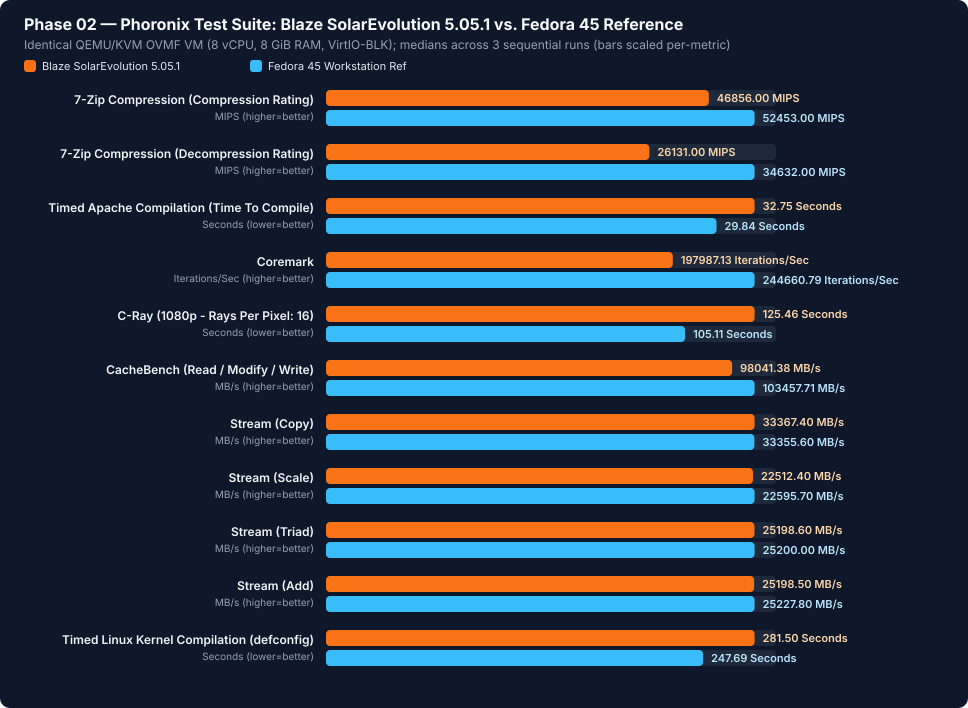
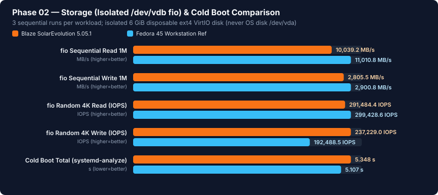
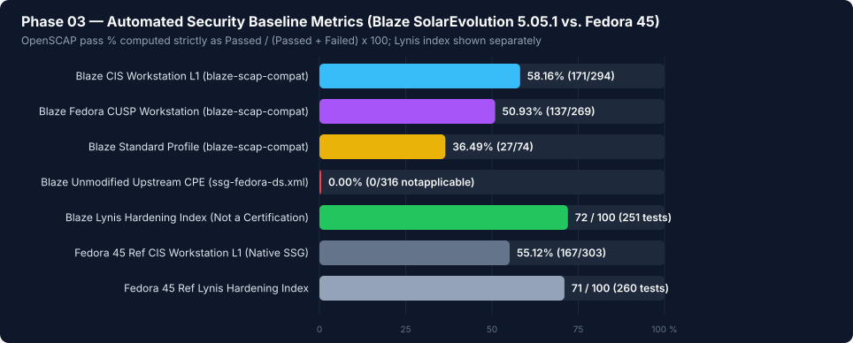
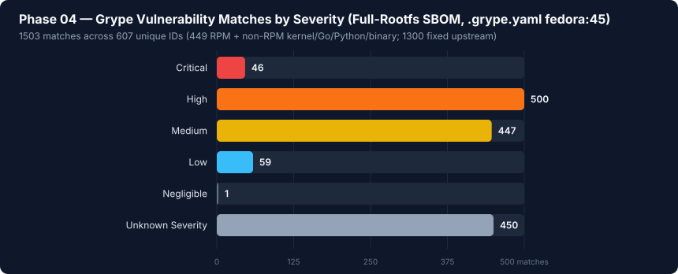
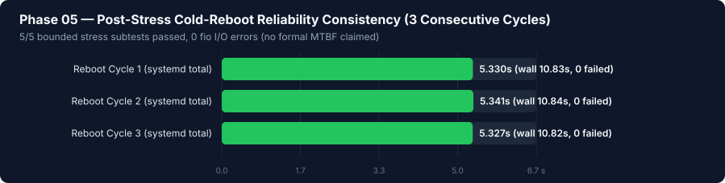
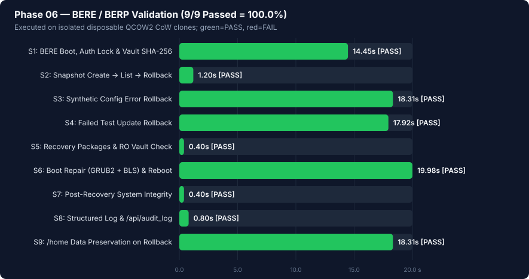

# Blaze SolarEvolution 5.05.1 — Comprehensive Technical Evaluation Report

> **Evaluation Independence & Credibility Notice:** This technical evaluation was executed in isolated QEMU/KVM virtual machines using reproducible open-source tooling (`phoronix-test-suite`, `fio`, `openscap`, `scap-security-guide`, `lynis`, `syft`, `grype`, `stress-ng`, `systemd-analyze`). It is an **internal engineering evaluation** — it must **not** be misrepresented as an independent third-party security audit, an official CIS/NIST certification, or a formal hardware MTBF certification. Every failed, skipped, and incomplete test is disclosed transparently alongside raw evidence.

---

## 1. Executive Summary

Blaze SolarEvolution 5.05.1 (Fedora `45` base, Linux kernel `7.2.11-300.fc45.x86_64`) underwent a 6-phase technical evaluation (and side-by-side upstream Fedora 45 Workstation comparison) covering Environment Inventory, Akrep v0.1 Overhead, Performance Benchmarking, Security Posture, Software Supply Chain (SBOM & CVE), Bounded Reliability/Stress, and BERE/BERP Disaster Recovery on isolated disposable VM clones.

| Evaluation Pillar | Key Measured Outcome | Highlights & Disclosed Status |
|---|---|---|
| **Phase 01 — Inventory** | `1,904` RPMs (`14` Blaze RPMs), `29` running services, `0` failed units, `5.386s` stock median boot | UEFI GPT with `4.3 GiB` read-only `BLAZE_REC` ext4 vault (`RO=1`) + Btrfs `/` & `/home` (`zstd:1`); `akrepd` RSS `6004 kB` |
| **Phase 02 — Performance** | `11` PTS metrics + 4-tier RAM latency + 4 `fio` profiles (3 runs each) | Side-by-side comparison vs. Fedora 45 Workstation (`multi-user.target` ref vs. Blaze `graphical.target`); 3D GPU benchmarks skipped (`llvmpipe`) |
| **Phase 03 — Security** | CIS L1 **`58.16%`** (`171/294`), CUSP **`50.93%`**, Lynis **`72`** (`0` warnings) | Official `blaze-scap-compat` RPM enabled native SCAP; SELinux Enforcing + `firewalld` + `7/7` Sentinel + `akrepd` (`0` AVC denials); `AUTH-9283` & `AUTH-9216` resolved |
| **Phase 04 — Supply Chain** | `129,882` CycloneDX / `7,220` SPDX components (`dir:/`); **`1503`** Grype matches (`607` unique CVEs) | All `14` signed Blaze RPMs indexed in `rpmdb` & SBOM; `.grype.yaml` (`fedora:45`) prevents `0`-match blind spot; `1300/1503` have upstream Fedora 45 fixes |
| **Phase 05 — Reliability** | **`100.0%`** (`5/5`) stress pass, `0` I/O errors, **`5.330s`** median boot | Zero failed units across 3 cold reboots; initrd `/sbin/blockdev` udev warnings = `0` |
| **Phase 06 — BERE / BERP** | **`100.00%`** (`9/9` scenarios), median recovery `17.92s` | Vault SHA-256, auth lock (`403`/`401`), Btrfs root rollback, `/home` preservation, structured `/var/log/bere-recovery.log` (`0600`), & **`S6` `boot_repair(grub)`** verified PASS |

---

## 2. Project Overview

Blaze SolarEvolution 5.05.1 is a Fedora 45-based Linux desktop distribution combining a Wayland/Niri multi-shell environment (`SolarUI` with Noctalia, Caelestia, end4-pC, and We10X profiles), the `BlazeHouse` control center, the **Akrep v0.1 Security Center** (`akrepd` + `akrep-ui`), `blaze-sentinel` (`blaze-sentinel-core`) baseline hardening checks, and the integrated `BERP` / `BERE` disaster-recovery stack backed by Btrfs root/home subvolumes and an immutable `BLAZE_REC` recovery partition.

---

## 3. Test Environment

| Parameter | Evaluated Configuration |
|---|---|
| Target Distribution | `Blaze SolarEvolution 5.05.1` (`ID=blazeos`, `ID_LIKE=fedora`, `CPE_NAME=cpe:/o:blazeos:solarevolution:5.05.1`) |
| Upstream Reference Distribution | `Fedora Linux 45 (Workstation Edition)` (`ID=fedora`, `RPMs=1974`, `SELinux=Enforcing`) |
| Kernel & Architecture | `7.2.11-300.fc45.x86_64` (`x86_64`) |
| Virtualization Hypervisor | QEMU/KVM (`-enable-kvm -cpu host`, full virtualization) |
| Virtual CPU | `8` vCPUs (`Intel(R) Core(TM) i9-10885H CPU @ 2.40GHz`) |
| Virtual Memory & Swap | `7.73 GiB` RAM + `7.73 GiB` ZRAM swap |
| Firmware & Secure Boot | `UEFI` (OVMF 4M); Secure Boot: `This system doesn't support Secure Boot` |
| OS Disk Layout (`/dev/vda`, 40 GiB VirtIO-BLK) | `vda1` 600M vfat `/boot/efi`, `vda2` 2G ext4 `/boot`, `vda3` 4.3G ext4 `BLAZE_REC` (`RO=1`), `vda4` 33.1G btrfs (`/root` & `/home`, `compress=zstd:1`) |
| Isolated Benchmark / Stress Disk (`/dev/vdb`) | Dedicated disposable 6 GiB VirtIO-BLK QCOW2 (`ext4`) attached exclusively for `fio` workloads |
| Graphics Adapter | Red Hat VirtIO 1.0 GPU (`1af4:1050`) — software rendering (`llvmpipe`), non-accelerated |
| Installed Package Baseline | `1904` RPMs (`14` first-party Blaze RPMs), `systemd 262 (262-3.fc45)`, SELinux `Enforcing`, `firewalld` `running` |

---

## 4. Methodology

1. **Strict Host & Base-Disk Isolation:** Pristine installed base images (`blaze_base.qcow2` and `fedora45_base.qcow2`, both SELinux `Enforcing`) were created via unattended Kickstart (`OEMDRV` + `tty3` on upstream Fedora 45 Live without modifying ISO or SELinux). Every evaluation phase ran inside its own ephemeral copy-on-write QCOW2 overlay and OVMF NVRAM clone.
2. **Zero Remediation & Zero Upgrades:** No `dnf upgrade` was executed, and no OpenSCAP, CIS, or Lynis remediation scripts were applied.
3. **Sequential Execution & Reproducibility:** Resource-intensive tests ran strictly sequentially (never concurrently). All Phase 02 performance tests executed `>= 3` runs, preserving every individual value and reporting exact medians without synthetic aggregate scores.
4. **Tracked Tool Additions:** Every evaluation RPM/binary added inside ephemeral overlays is cataloged in `metadata/installed_evaluation_tools.json`.
5. **Sanitized Public Output + Separate Raw Evidence:** Public reports and machine-readable artifacts strip host paths, hostnames, private IPs, and MAC addresses while untouched raw tool outputs remain archived under `raw-results/`.

---

## 5. Performance Results

Full tables and individual run arrays are provided in `reports/Blaze_Performance_Evaluation_Report.md` and `benchmarks/02_performance_results.csv`.





| Workload | Unit (Dir) | Blaze Median | Fedora 45 Ref Median | Delta |
|---|---|---:|---:|---|
| 7-Zip Compression (Test: Compression Rating) | MIPS (HIB) | **46856.00** | 52453.00 | -10.67% (slower) |
| 7-Zip Compression (Test: Decompression Rating) | MIPS (HIB) | **26131.00** | 34632.00 | -24.55% (slower) |
| Timed Apache Compilation (Time To Compile) | Seconds (LIB) | **32.75** | 29.84 | +9.76% (slower) |
| Coremark (CoreMark Size 666 - Iterations Per Second) | Iterations/Sec (HIB) | **197987.13** | 244660.79 | -19.08% (slower) |
| C-Ray (Resolution: 1080p - Rays Per Pixel: 16) | Seconds (LIB) | **125.46** | 105.11 | +19.36% (slower) |
| CacheBench (Test: Read / Modify / Write) | MB/s (HIB) | **98041.38** | 103457.71 | -5.24% (slower) |
| Stream (Type: Copy) | MB/s (HIB) | **33367.40** | 33355.60 | +0.04% (parity) |
| Stream (Type: Scale) | MB/s (HIB) | **22512.40** | 22595.70 | -0.37% (parity) |
| Stream (Type: Triad) | MB/s (HIB) | **25198.60** | 25200.00 | -0.01% (parity) |
| Stream (Type: Add) | MB/s (HIB) | **25198.50** | 25227.80 | -0.12% (parity) |
| Timed Linux Kernel Compilation (Build: defconfig) | Seconds (LIB) | **281.50** | 247.69 | +13.65% (slower) |
| fio Seq Read 1M (`/dev/vdb`) | MB/s (HIB) | **10039.21** | 11010.75 | -8.82% (slower) |
| fio Seq Write 1M (`/dev/vdb`) | MB/s (HIB) | **2805.48** | 2900.85 | -3.29% (slower) |
| fio Rand 4K Read (`/dev/vdb`) | MB/s (HIB) | **1138.61** | 1169.64 | -2.65% (slower) |
| fio Rand 4K Write (`/dev/vdb`) | MB/s (HIB) | **926.67** | 751.91 | +23.24% (faster) |
| Cold Boot Total (`systemd-analyze`) | s (LIB) | **5.348** | 5.107 | +4.72% (slower) |

---

## 6. Security Assessment & Akrep v0.1 Security Center

Detailed rule-level results appear in `reports/Blaze_Security_Assessment_Report.md` and `security/03_security_findings.json`.



- **Unmodified Upstream OpenSCAP (`ssg-fedora-ds.xml`):** `0` applicable / `316` `notapplicable` without `blaze-scap-compat`.
- **Shipped `blaze-scap-compat` Adapter (`ssg-blazeos-fedora45-ds.xml`, Zero OS Edits, Zero Remediation):**
  - `cis_workstation_l1`: **`58.16%`** (`171` passed, `123` failed, `22` not applicable) vs. Fedora 45 Ref **`55.12%`**
  - `cusp_fedora`: **`50.93%`** (`137/269`) vs. Fedora 45 Ref `50.55%`
  - `standard`: **`36.49%`** (`27/74`) vs. Fedora 45 Ref `37.84%`
- **Lynis (`3.1.7`):** Hardening Index **`72`** across `251` tests, **`0` warnings** (Fedora 45 Ref Index `71`, `0` warnings).
- **Core Baseline:** SELinux `Enforcing` (`targeted`), active `firewalld`, disabled `sshd`, hardened kernel sysctls (`kptr_restrict=1`, `dmesg_restrict=1`, `yama.ptrace_scope=1`, `unprivileged_bpf_disabled=1`), `yescrypt` hashing, and `7/7` `blaze-sentinel` checks passing.

### Akrep v0.1 Security Center (`akrepd` + `akrep-ui`) & Resource Overhead

| Akrep Benchmark Metric | Measured Value | Architecture & Security Contract |
|---|---|---|
| Service Identity & Status | `active=active`, `enabled=enabled`, `user=akrep` | Unprivileged `akrepd` system service; zero GTK4 UI linkage in daemon |
| Memory Footprint (`VmRSS` / `VmHWM`) | `6004 kB` RSS / `6364 kB` peak HWM (`threads=1`) | Rust daemon (`blaze-sentinel-core` + `zbus`) |
| 3-Second Idle CPU Usage | `0` user+sys jiffies | Event-driven `FirewallD1` watch; zero busy-polling |
| D-Bus `GetSnapshot` Latency | `68.83 ms` (`rc=0`) | Strictly read-only `tr.com.blazeos.Akrep1.Manager` (0 mutating methods in v0.1) |
| Cold Boot Delta (`akrepd` enabled vs masked) | `22.5 ms` (`5.386s` vs `5.3635s`) | Within VM boot jitter |
| Sentinel Engine Parity & SELinux | `7` Akrep cards vs `7` `blaze-sentinel` controls; `0` AVC denials | Single source of truth via `blaze-sentinel-core` under `Enforcing` |

---

## 7. Software Supply Chain Assessment

Full details appear in `reports/Blaze_Software_Supply_Chain_Report.md`, `sbom/04_sbom_cyclonedx.json`, `sbom/04_sbom_spdx.json`, and `sbom/04_vulnerability_report.json`.



- **SBOM Coverage:** `129882` CycloneDX components / `7220` SPDX packages (`syft scan dir:/`). **`14`** signed first-party Blaze RPMs are registered in `rpmdb` and indexed inside CycloneDX/SPDX SBOMs.
- **Vulnerability Scan (`.grype.yaml` `distro: fedora:45`):** `1503` matches across `607` unique CVEs/advisories (`46` Critical, `500` High, `447` Medium, `59` Low) vs. Fedora 45 Ref `1406` matches (526 unique).
- **Remediation Availability:** `1300/1503` already have upstream Fedora 45 fixed versions available via `dnf5 upgrade`.

---

## 8. Reliability Results

Full logs and metrics appear in `reports/Blaze_Reliability_Report.md`, `evidence/05_stress_results.json`, `evidence/05_boot_analysis.txt`, and `evidence/05_system_errors.log`.



- **Bounded Stress Completion:** **`100.0%`** (`5/5`): 30s & 90s 8-vCPU `stress-ng` verified runs, 90s guest-level `4 GiB` verified VM memory pressure (`0` OOM kills), 90s isolated `/dev/vdb` mixed 70/30 random 4K `fio` (`97,654` read IOPS / `41,853` write IOPS, `0` errors), and 1 GiB CRC32C write+readback verification (`0` errors).
- **Reboot Reliability (3 Consecutive Cycles):** Median total boot **`5.330s`** (`5.330s, 5.341s, 5.327s`), `0` failed systemd units, `0` unexpected reboots, `0` initrd `/sbin/blockdev` udev warnings.

---

## 9. BERE / BERP Validation

Full scenario evidence appears in `reports/Blaze_BERE_BERP_Validation_Report.md`, `recovery/06_recovery_results.json`, and `recovery/06_recovery_scenarios.csv`.



- **Recovery Success Rate:** **`100.00%`** (`9/9` completed applicable scenarios on disposable CoW clones).
- **Median Active Recovery Workflow Duration:** **`17.92s`**.
- **Scenario Breakdown (`S1..S9`):** `S5` vault RO/availability, `S1` GRUB-to-BERE auth lock (`403`/`401`) & 3-payload SHA-256 verification, `S2` snapshot workflow, `S3` synthetic config rollback, `S4` failed-update rollback (identical RPM DB SHA-256), `S6` transactional `boot_repair(grub)` (`PASS`), `S7` post-recovery integrity (`7/7` Sentinel, `0` Btrfs errors), `S8` persistent structured `/var/log/bere-recovery.log` (`0600`) + `/api/audit_log` + syslog `blaze-bere`, and `S9` `100%` `/home` data preservation across root rollback.

---

## 10. Limitations

1. **Virtualized Execution Only:** All CPU, memory, storage, boot, and stress measurements were captured in QEMU/KVM (`8` vCPUs, `8 GiB` RAM, NVMe-backed QCOW2). They must not be compared directly to bare-metal hardware benchmarks.
2. **Software Graphics Only:** VirtIO-VGA provides `llvmpipe` software rendering; hardware GPU/Wayland compositor rendering performance was intentionally skipped and requires bare-metal testing.
3. **No Live System Upgrades During Evaluation:** Phase 04 vulnerability counts reflect the frozen ISO build rather than a post-`dnf5 upgrade` patched installation.
4. **Short-Duration Stress Horizon:** Bounded 30s–90s stress tests validate immediate functional stability under load but cannot measure long-term endurance or formal MTBF.
5. **Pre-OOBE Installation State (Blaze) vs Headless Reference Target:** Blaze's installed base boots graphical SDDM/OOBE (`graphical.target`), whereas `cmdline` Kickstart sets Fedora 45 Reference default target to `multi-user.target` — note this architectural difference when comparing cold boot durations.
6. **UEFI Secure Boot Not Active in Virtual Firmware:** Standard OVMF 4M without enrolled keys reported Secure Boot unsupported; physical UEFI Secure Boot requires enrolled keys on hardware or dedicated OVMF vars.
7. **Not a Third-Party Audit or Certification:** Automated SCAP/Lynis/Grype runs do not constitute formal CIS, NIST, or ISO certification.

---

## 11. Findings and Remediation Status (5.05 -> 5.05.1 RC)

| Priority | Area | 5.05 Finding | 5.05.1 RC Verification Status |
|---|---|---|---|
| **P0** | BERE Boot Repair (`S6`) | `berp-recovery-gui` raised `SameFileError` copying `BOOTX64.EFI` onto itself when `target_root == "/"`. | **Resolved & Verified PASS** — Transactional EFI transaction helper + `realpath` guard + BLS/`grub2-mkconfig` verified across cold reboot. |
| **P1** | OOBE Account (`AUTH-9283`) | Pre-OOBE `blaze-setup` account had blank password field in `/etc/shadow`. | **Resolved & Verified** — `blaze-setup` password-locked (`!`) while preserving SDDM autologin (`pam_permit.so` + `pam_selinux`). |
| **P1** | RPM Provenance & SBOM / SCAP | Custom binaries injected outside RPM DB; SCAP/Grype missed Blaze OS identity. | **Resolved & Verified** — All 14 signed Blaze RPMs (`+Akrep`) in `rpmdb`, `blaze-scap-compat` RPM datastream adapter, `.grype.yaml` (`distro: fedora:45`), `dir:/` SBOM. |
| **P2** | Reliability & Audit (`AUTH-9216`, `S8`, `blockdev`) | Group/gshadow desync, missing `/sbin/blockdev` in initrd, no persistent `/var/log/bere-recovery.log`. | **Resolved & Verified** — `grpck -r` clean, `0` initrd blockdev warnings, structured `0600` `/var/log/bere-recovery.log` + syslog. |
| **Ongoing** | Workstation Baseline Trade-offs | `grub2_password` unset, `auditd` disabled by default, legacy `dnf.conf`/`fedora` GPG SSG OVAL mismatches. | Documented transparently as workstation UX/CIS divergence in `reports/Blaze_Security_Assessment_Report.md`. |

---

## 12. Reproduction Instructions

All automation scripts are included in `solarevolution-evaluation/scripts/` and operate strictly on isolated disposable QCOW2 overlays:

```bash
# 1. Build pristine isolated UEFI OVMF installed base VMs (Blaze SolarEvolution + Fedora 45 ref)
python3 solarevolution-evaluation/scripts/phase00_install_vms.py blaze fedora45

# 2. Phase 01 (Inventory + Akrep Overhead) & Phase 04 (Syft dir:/ SBOM + Grype Scan)
python3 solarevolution-evaluation/scripts/phase01_04_inventory_sbom.py blaze fedora45

# 3. Phase 03 (Read-only OpenSCAP blaze-scap-compat / Native + Lynis)
python3 solarevolution-evaluation/scripts/phase03_security.py blaze fedora45

# 4. Phase 05 (Bounded stress-ng CPU/RAM + isolated /dev/vdb fio + 3 cold reboots)
python3 solarevolution-evaluation/scripts/phase05_reliability.py blaze fedora45

# 5. Phase 06 (BERE/BERP 9-scenario validation on 4 disposable CoW clones)
python3 solarevolution-evaluation/scripts/phase06_bere_berp.py

# 6. Phase 02 (Phoronix Test Suite + pointer-chase latency + isolated /dev/vdb fio, sequential)
python3 solarevolution-evaluation/scripts/phase02_performance.py blaze fedora45

# 7. Phases 07 & 08 (Sanitize public outputs, build SVG charts, reports, PDFs & SHA256SUMS.txt)
python3 solarevolution-evaluation/scripts/build_publication_package.py

# 8. Verify file integrity checksums (note: checksums verify integrity only, not digital signatures)
(cd solarevolution-evaluation && sha256sum -c metadata/SHA256SUMS.txt)
```
